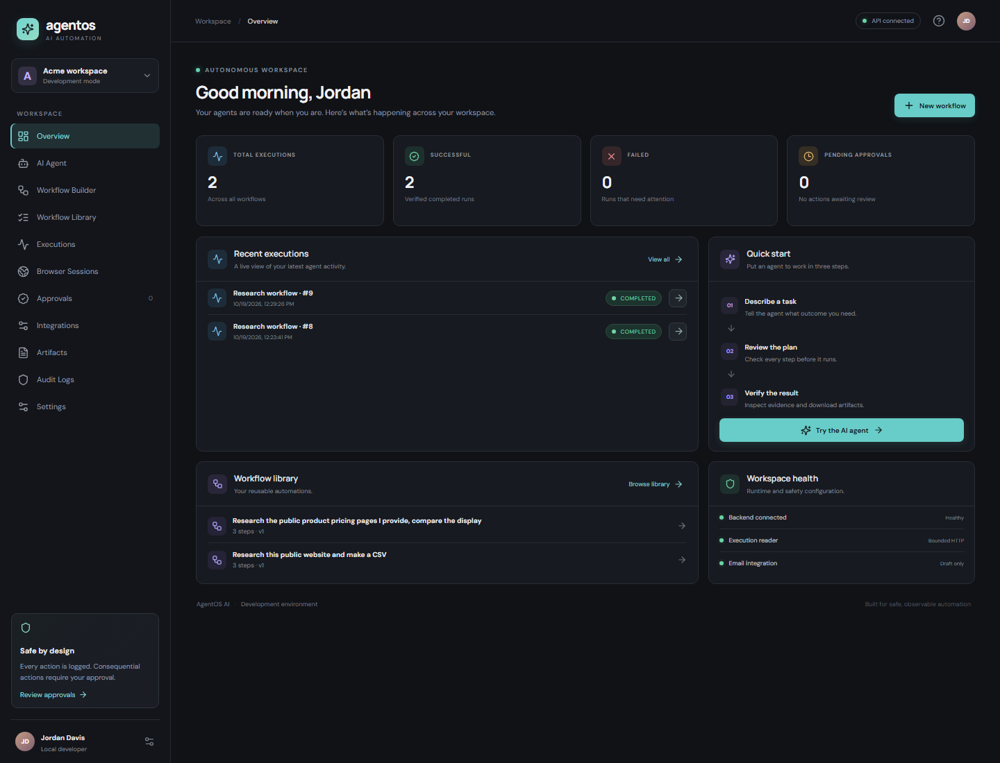
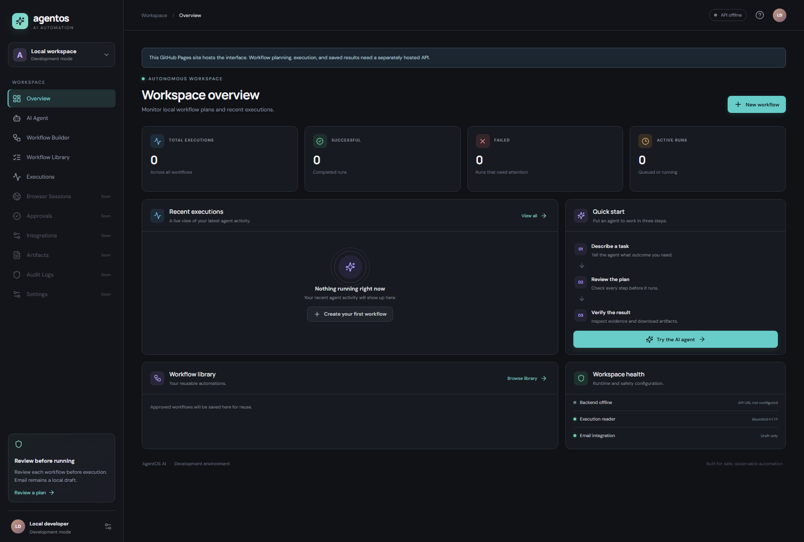

# AgentOS AI

Describe the task. Watch the agent work. Verify every result.

AgentOS AI is a local-first workflow automation MVP that turns a natural-language research request into a reviewable, bounded workflow. Approve a plan, collect evidence from public pages, follow persisted execution progress, and download the generated CSV. Planning works without credentials; an optional OpenAI-compatible planner can be configured. Email is draft-only and is never sent.

## What it does

- Converts a task and supplied public URLs into a schema-validated research → CSV → email-draft plan.
- Requires a separate user action to approve and start the workflow.
- Reads public HTTP(S) pages with URL, redirect, timeout, and response-size limits.
- Persists workflow, execution, and step state in SQLite or PostgreSQL.
- Captures source URLs, extracted titles, descriptions, evidence snippets, and timestamps.
- Generates a downloadable CSV from collected results and records a local unsent email draft.
- Shows recent execution data, an execution inspector, and a draggable React Flow plan canvas.

## Quick start

Requirements: Python 3.11+, Node 20+. Docker is optional.

1. In a terminal, copy `.env.example` to `.env` and optionally configure an LLM provider.
2. Start the API: `cd backend; python -m venv .venv; .venv\Scripts\activate; pip install -r requirements.txt; alembic upgrade head; uvicorn app.main:app --reload`
3. Start the UI in another terminal: `cd frontend; npm ci; npm run dev`
4. Open `http://localhost:5173`. API docs are at `http://localhost:8000/docs`.

Or run the local stack with Docker Compose: `docker compose up --build`. The UI, API, and database ports bind to loopback for local development.

## GitHub Pages preview

The frontend is deployed automatically from `main` to [GitHub Pages](https://abhinavrenjithg-sys.github.io/AgentOS-AI/). GitHub Pages serves static files; the FastAPI service runs separately. To create a demo API and PostgreSQL database from this repository, sign in to Render with GitHub and deploy the [Render Blueprint](https://render.com/deploy?repo=https://github.com/abhinavrenjithg-sys/AgentOS-AI). After the first deploy, add a repository Actions variable named `AGENTOS_API_BASE` with the Render API URL and `/api/v1` suffix, for example `https://agentos-api.onrender.com/api/v1`. Push to `main` (or rerun the Pages workflow) to rebuild the frontend with the API URL.

The Blueprint uses free Render resources for a personal demo. Free web services sleep after 15 minutes without traffic, and free Render Postgres expires after 30 days; see [Render's current free-instance limits](https://render.com/docs/free). Upgrade the database before expiry to keep its data. This deployment is a public, single-workspace demo with no accounts or production authorization: do not submit secrets or sensitive data. The API already restricts research to bounded public HTTP(S) pages, but that does not replace authentication, rate limits, and network egress controls for a production service.

Generated CSV bytes are stored in PostgreSQL so downloads survive Render's ephemeral application filesystem. Artifacts created before the storage migration continue to use their local files.

If port 8000 is already occupied, start the API with `uvicorn app.main:app --reload --port 8123`, then set `VITE_API_BASE=http://localhost:8123/api/v1` in the frontend environment (see `frontend/.env.example`).

Local dev uses SQLite and a single-user development workspace; it is not production authentication. The API allows only public HTTP(S) URLs, checks resolved addresses and redirects, streams responses with a 1.5 MB body cap, and does not run arbitrary model-generated code. The MVP uses a bounded HTTP reader, not Playwright, and reports that honestly in the execution record. DNS rebinding remains a documented risk; use network-level egress controls before exposing the service to untrusted users.

## Demonstration

Enter a research request (or use the example), inspect the generated plan, then click **Approve & run**. Execution progress is persisted and polled. Public URLs discovered by the deterministic planner are fetched, title/description and evidence snippets are extracted, and a CSV is produced only from collected records. A request with no URLs will ask for source URLs instead of fabricating them. Errors are surfaced per source. The email step creates a local draft record only.

## Architecture

- `backend/app`: FastAPI API, SQLAlchemy models, bounded deterministic planner, URL policy, execution engine, and artifact generation.
- `frontend`: React + TypeScript + Vite single-page application. Workflow plan and execution inspector are functional.
- `docker-compose.yml`: PostgreSQL-ready local service composition; Docker is optional.
- `docs`: architecture and security notes.

The MVP favors a small modular monolith and SQLite for zero-setup local use. Set `DATABASE_URL` to a PostgreSQL SQLAlchemy URL for shared persistent storage. No Redis or durable task queue is introduced: executions run in an in-process background task and persist state, so restarting the API can interrupt a run. This recovery limitation is documented and visible.

## Configuration

See `.env.example`. LLM planning requires an OpenAI-compatible endpoint and API key; without them, the deterministic planner is used. Provider output is schema-validated. Third-party email credentials are intentionally not supported; drafts remain local.

## Known limitations

- Development mode has no accounts, workspace membership enforcement, or production-grade authorization.
- The initial planner supports a bounded public research workflow, not arbitrary workflow authoring or arbitrary actions.
- The canvas previews ordered steps and lets users arrange them visually; edited node positions are not persisted.
- Pause, cancel, retry, reusable workflow version history, and full audit log APIs are not implemented yet.
- URL protections reduce SSRF risk but cannot replace network-level egress controls in a production deployment.
- HTTP extraction may not render JavaScript-heavy pages. No active browser session is claimed by the default adapter.
- In-process execution can be interrupted by process restart; use a durable worker/queue before production.
- CSV and run records are stored locally; retention and multi-user artifact access controls need production hardening.

## Verify

Backend: `cd backend; python -m pytest`

Frontend: `cd frontend; npm test` and `npm run build`

Tests cover planner validation, URL policy, isolated persistence, workflow execution, the approval gate, CSV formula neutralization, and artifact generation. CI runs backend lint/format checks, backend tests, frontend tests, and the production frontend build.
